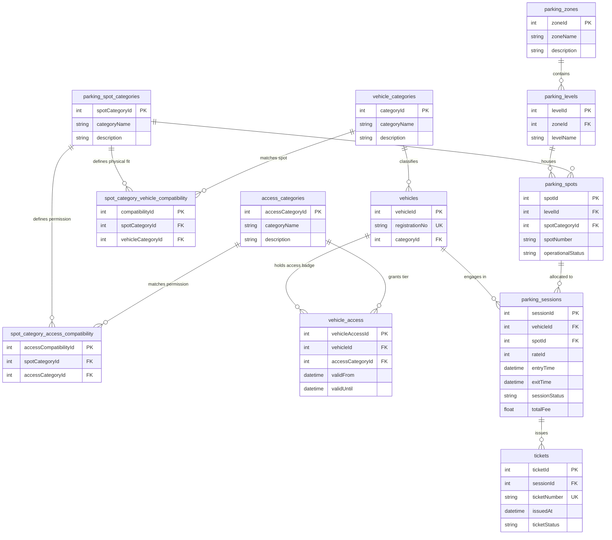

# 🚗 Comic-Con Parking System — Database Design

[](https://www.postgresql.org/)
[](#)
[](../README.md)

A production-grade relational database design for a high-traffic convention and entertainment venue parking ecosystem, modeled after **Comic-Con International**.

---

## 📌 Problem Statement & Context

Massive pop-culture conventions like **Comic-Con** present unique logistical challenges that traditional parking systems fail to accommodate:

1. **Diverse Vehicle Profiles**: From motorbikes and electric vehicles (EVs) requiring charging stations to standard family cars, accessibility vans, and heavy multi-axle production/broadcast trucks.
2. **Multi-Tier Access Credentials**: Attendees range from standard day-pass holders to VIP celebrity talent, exhibitor staff, cosplayers with oversized equipment, media/press crews, and event operations staff.
3. **Complex Spatial Hierarchies**: Convention centers span multiple outdoor surface lots, underground multi-level garages, and backstage restricted security bays.
4. **Time-Bounded Privileges**: Exhibitor and VIP parking passes are only valid for designated operational windows (e.g., pre-event load-in vs. show floor hours).

This database design solves these problems by separating **physical spatial compatibility** from **credential-based access permissions** using normalized relational tables and junction compatibility layers.

---

## 🗺️ Entity Relationship (ER) Diagram


### Mermaid Architecture View



---

## 🏛️ Database Dictionary & Schema Specifications

### 1. Spatial Structure Entities

#### `parking_zones`
Represents the highest level of geographic division across the convention grounds.
* `zoneId` (INT, PK, Auto Increment) — Unique zone identifier.
* `zoneName` (VARCHAR(100), UNIQUE, NOT NULL) — Human-readable zone designation (e.g., `North Arena Lot`, `Underground Deck`, `Backstage VIP`).
* `description` (TEXT) — Operational details, gate instructions, and overhead clearance.

#### `parking_levels`
Vertical or sectional sublevels within a parking zone.
* `levelId` (INT, PK, Auto Increment) — Unique level identifier.
* `zoneId` (INT, FK -> `parking_zones.zoneId`) — Foreign key linking level to parent zone.
* `levelName` (VARCHAR(100), NOT NULL) — Level name (e.g., `Surface Ground`, `Level B1`, `Rooftop Bay`).

#### `parking_spots`
The individual physical stalls where vehicles park.
* `spotId` (INT, PK, Auto Increment) — Unique spot identifier.
* `levelId` (INT, FK -> `parking_levels.levelId`) — Foreign key to level.
* `spotCategoryId` (INT, FK -> `parking_spot_categories.spotCategoryId`) — Foreign key defining the physical attributes of this spot.
* `spotNumber` (VARCHAR(50), NOT NULL) — Alphanumeric bay label (e.g., `A-101`, `EV-04`, `VIP-12`).
* `operationalStatus` (VARCHAR(50), NOT NULL, DEFAULT `'available'`) — Current physical state: `available`, `occupied`, `maintenance`, `reserved`.

---

### 2. Vehicle & Category Classification

#### `vehicle_categories`
Physical vehicle classifications.
* `categoryId` (INT, PK, Auto Increment) — Unique category identifier.
* `categoryName` (VARCHAR(100), UNIQUE, NOT NULL) — E.g., `Motorcycle`, `Sedan`, `SUV`, `Electric Vehicle`, `Production Van`, `Semi-Trailer`.
* `description` (TEXT) — Size, length, weight, and electrical requirements.

#### `vehicles`
Profiles of vehicles that register or enter convention gates.
* `vehicleId` (INT, PK, Auto Increment) — Internal surrogate identifier.
* `registrationNo` (VARCHAR(50), UNIQUE, NOT NULL) — License plate / state registration number.
* `categoryId` (INT, FK -> `vehicle_categories.categoryId`) — Vehicle type.

#### `parking_spot_categories`
Physical categories of parking spaces.
* `spotCategoryId` (INT, PK, Auto Increment) — Unique spot category identifier.
* `categoryName` (VARCHAR(100), UNIQUE, NOT NULL) — E.g., `Compact Bay`, `Standard Stall`, `EV Charging Bay`, `Handicap Accessible`, `Heavy Truck Berth`.
* `description` (TEXT) — Equipment fitted (chargers, ramps, height clearance).

---

### 3. Dual Compatibility & Access Control Layer

#### `access_categories`
Credential tiers assigned to convention participants.
* `accessCategoryId` (INT, PK, Auto Increment) — Unique identifier.
* `categoryName` (VARCHAR(100), UNIQUE, NOT NULL) — E.g., `General Public`, `Exhibitor / Vendor`, `Media & Press`, `Event Staff / Security`, `VIP Guest / Celebrity`.
* `description` (TEXT) — Access privileges and gate authorization policy.

#### `spot_category_vehicle_compatibility`
*Junction Table* resolving physical compatibility: **Can vehicle type X fit into spot category Y?**
* `compatibilityId` (INT, PK, Auto Increment) — Surrogate key.
* `spotCategoryId` (INT, FK -> `parking_spot_categories.spotCategoryId`)
* `vehicleCategoryId` (INT, FK -> `vehicle_categories.categoryId`)
* *Unique Constraint*: `(spotCategoryId, vehicleCategoryId)`

#### `spot_category_access_compatibility`
*Junction Table* resolving security authorization: **Can credential tier X occupy spot category Y?**
* `accessCompatibilityId` (INT, PK, Auto Increment) — Surrogate key.
* `spotCategoryId` (INT, FK -> `parking_spot_categories.spotCategoryId`)
* `accessCategoryId` (INT, FK -> `access_categories.accessCategoryId`)
* *Unique Constraint*: `(spotCategoryId, accessCategoryId)`

#### `vehicle_access`
Binds vehicles to specific access categories within scheduled convention dates.
* `vehicleAccessId` (INT, PK, Auto Increment) — Surrogate key.
* `vehicleId` (INT, FK -> `vehicles.vehicleId`) — Vehicle granted access.
* `accessCategoryId` (INT, FK -> `access_categories.accessCategoryId`) — Granted tier.
* `validFrom` (DATETIME / TIMESTAMP, NOT NULL) — Starting timestamp of authorized window.
* `validUntil` (DATETIME / TIMESTAMP, NOT NULL) — Expiration timestamp.
* *Check Constraint*: `validUntil > validFrom`

---

### 4. Session Tracking & Ticketing

#### `parking_sessions`
Captures the real-time operational lifecycle of a vehicle inside the facility.
* `sessionId` (INT, PK, Auto Increment) — Unique session identifier.
* `vehicleId` (INT, FK -> `vehicles.vehicleId`) — Parked vehicle.
* `spotId` (INT, FK -> `parking_spots.spotId`) — Allocated spot.
* `rateId` (INT) — Reference to the rate plan applied (flat event fee, hourly rate, or complimentary).
* `entryTime` (DATETIME / TIMESTAMP, NOT NULL, DEFAULT `NOW()`) — Gate entry timestamp.
* `exitTime` (DATETIME / TIMESTAMP, NULLABLE) — Gate exit timestamp (recorded upon payment/departure).
* `sessionStatus` (VARCHAR(50), NOT NULL, DEFAULT `'active'`) — State: `active`, `completed`, `cancelled`.
* `totalFee` (FLOAT / NUMERIC(10, 2), DEFAULT `0.00`) — Final calculated charge.

#### `tickets`
The physical or digital gate artifact issued to drivers upon entry.
* `ticketId` (INT, PK, Auto Increment) — Unique ticket record.
* `sessionId` (INT, FK -> `parking_sessions.sessionId`) — Associated session.
* `ticketNumber` (VARCHAR(100), UNIQUE, NOT NULL) — Scannable barcode, QR code, or RFID serial.
* `issuedAt` (DATETIME / TIMESTAMP, NOT NULL, DEFAULT `NOW()`) — Issuance time.
* `ticketStatus` (VARCHAR(50), NOT NULL, DEFAULT `'active'`) — States: `active`, `validated`, `paid`, `lost`.

---

## ⚡ Core Business Rules & Validations

1. **Dual Validation Gate Check**:
   Before a vehicle is assigned to a parking spot, the query engine validates:
   - **Physical Fit**: Does a record exist in `spot_category_vehicle_compatibility` for `(spot.spotCategoryId, vehicle.categoryId)`?
   - **Access Authorization**: Is the vehicle's `vehicle_access` active (`validFrom <= NOW() <= validUntil`), and does `spot_category_access_compatibility` permit that `accessCategoryId`?
2. **Atomic Spot Allocation**:
   When a session starts, `parking_spots.operationalStatus` transitions from `'available'` to `'occupied'` inside a database transaction to prevent double-booking.
3. **Session Exit & Calculation**:
   On checkout, `exitTime` is set, `sessionStatus` changes to `'completed'`, `totalFee` is computed based on duration, and the spot returns to `'available'`.

---

## 💻 Sample SQL Queries

### 1. Find Available Spots for an Incoming Electric Vehicle with VIP Access

```sql
SELECT 
    ps.spot_id,
    ps.spot_number,
    pl.level_name,
    pz.zone_name,
    psc.category_name
FROM parking_spots ps
JOIN parking_levels pl ON ps.level_id = pl.level_id
JOIN parking_zones pz ON pl.zone_id = pz.zone_id
JOIN parking_spot_categories psc ON ps.spot_category_id = psc.spot_category_id
-- Check physical compatibility with EV (vehicle_category_id = 4)
JOIN spot_category_vehicle_compatibility scvc 
    ON scvc.spot_category_id = psc.spot_category_id 
    AND scvc.vehicle_category_id = 4
-- Check access clearance for VIP (access_category_id = 2)
JOIN spot_category_access_compatibility scac 
    ON scac.spot_category_id = psc.spot_category_id 
    AND scac.access_category_id = 2
WHERE ps.operational_status = 'available'
ORDER BY pz.zone_id, ps.spot_number;
```

### 2. Check-In: Begin Parking Session & Issue Ticket

```sql
BEGIN;

-- 1. Reserve the spot
UPDATE parking_spots
SET operational_status = 'occupied'
WHERE spot_id = 12 AND operational_status = 'available';

-- 2. Create the session
INSERT INTO parking_sessions (vehicle_id, spot_id, rate_id, entry_time, session_status)
VALUES (1, 12, 1, NOW(), 'active')
RETURNING session_id;

-- 3. Issue gate ticket (using returned session_id, e.g., 101)
INSERT INTO tickets (session_id, ticket_number, issued_at, ticket_status)
VALUES (101, 'CC-2026-X892', NOW(), 'active');

COMMIT;
```

---

## 📁 Files Included

* [`Comic-Con Parking System final.png`](./Comic-Con%20Parking%20System%20final.png) — High-resolution entity relationship diagram.
* [`schema.sql`](./schema.sql) — Complete, executable PostgreSQL / MySQL DDL script with indexes and Comic-Con weekend sample seed data.
* [`README.md`](./README.md) — Comprehensive technical documentation and query guide.
